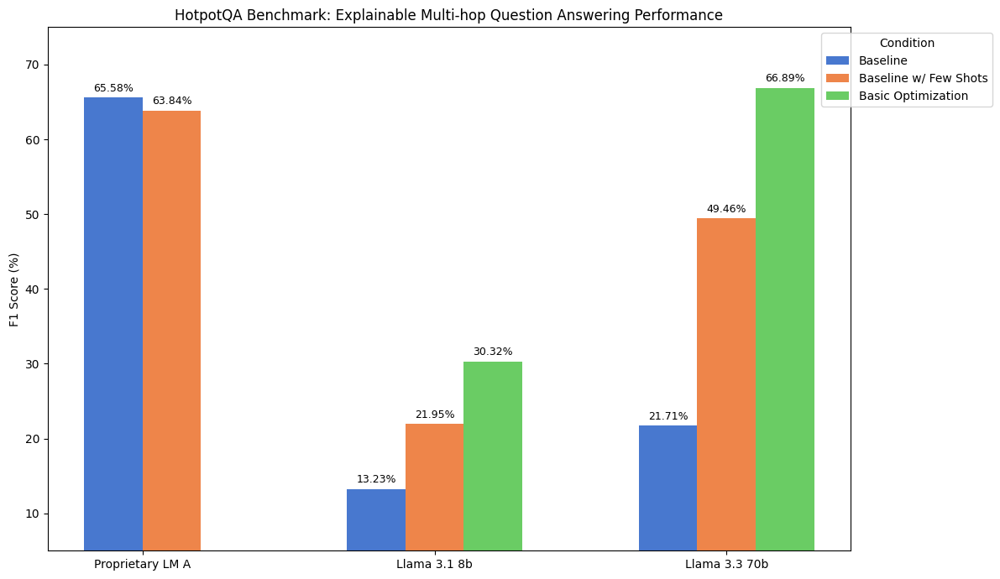

<h1 align="center"> Prompt Ops </h1>

<p align="center">
  <a href="README.md">English</a> · <b>简体中文</b>
</p>

### 🎉 新动态：Prompt Duel Optimizer (PDO，提示词对决优化器) 论文正式发布！

我们发表了关于 **PDO（Prompt Duel Optimizer，提示词对决优化器）** 的最新论文——这是一种利用对决多臂老虎机（Dueling Bandits）与汤普森采样（Thompson Sampling）的高效无标注提示词优化方法。PDO 在 BIG-bench Hard 和 MS MARCO 基准评测中均取得了当前业界顶尖（SOTA）的成绩。

📄 **阅读论文：** [LLM Prompt Duel Optimizer: Efficient Label-Free Prompt Optimization](https://www.arxiv.org/abs/2510.13907) (arXiv:2510.13907)

🧪 **亲自体验：** 查看展示 PDO 在逻辑推理任务上应用的 [谎言之网用例（Web of Lies use case）](use-cases/web-of-lies-pdo/)

⭐ **Star 本仓库** 持续关注——我们即将发布详细的教程 Notebook！

---

## 什么是 prompt-ops？
<p align="center">
  <a href="https://pypi.org/project/prompt-ops/"></a>
</p>
<p align="center">
  <a href="https://llama.developer.meta.com/?utm_source=prompt-ops&utm_medium=readme&utm_campaign=main"></a>
  <a href="https://llama.developer.meta.com/docs?utm_source=prompt-ops&utm_medium=readme&utm_campaign=main"></a>

</p>

<p align="center">
  <a href="https://github.com/meta-llama/llama-models/blob/main/models/?utm_source=prompt-ops&utm_medium=readme&utm_campaign=main"></a>
  <a href="https://www.llama.com/docs/overview/?utm_source=prompt-ops&utm_medium=readme&utm_campaign=main"></a>
  <a href="https://huggingface.co/meta-llama"></a>

</p>
<p align="center">
  <a href="https://github.com/meta-llama/synthetic-data-kit"></a>
  <a href="https://github.com/meta-llama/prompt-ops"></a>
    <a href="https://github.com/meta-llama/llama-cookbook"></a>
</p>


prompt-ops 是一个专为 Llama 模型设计、用于**自动优化提示词（Prompt）**的 Python 软件包。它可以将适配其他大语言模型效果较好的提示词，直接转换并优化为适配 Llama 系列模型的优质提示词，显著提升模型的下游推理表现与输出可靠性。

**核心优势：**
- **告别盲目试错**：无需再手动反复微调提示词以获得更优结果
- **极速优化体验**：借助基于模板的优化机制，数分钟内即可获得专为模型优化的提示词
- **数据驱动提升**：基于你自己的业务数据样例，量身打造契合特定业务场景的提示词
- **可量化的评估结果**：支持通过丰富的自定义评估指标，客观量化提示词的性能改善

## 环境与前置要求

开始使用 prompt-ops 之前，你需要准备：

- 现有的系统提示词（System Prompt）：你希望进行优化的既有系统提示词
- 现有的查询-响应数据集（Query-Response Dataset）：包含查询-响应对的 JSON 文件（最少仅需 50 个样例），用于评估与优化（详见下方的[准备数据集](#preparing-your-data)）
- 配置文件：指定模型超参数与优化细节的 YAML 配置文件（config.yaml）（参见[示例配置](configs/facility-simple.yaml)）

## 工作原理

```
┌──────────────────────────┐  ┌──────────────────────────┐  ┌────────────────────┐
│  Existing System Prompt  │  │  set(query, responses)   │  │ YAML Configuration │
└────────────┬─────────────┘  └─────────────┬────────────┘  └───────────┬────────┘
             │                              │                           │
             │                              │                           │
             ▼                              ▼                           ▼
         ┌────────────────────────────────────────────────────────────────────┐
         │                     prompt-ops migrate                       │
         └────────────────────────────────────────────────────────────────────┘
                                            │
                                            │
                                            ▼
                                ┌──────────────────────┐
                                │   Optimized Prompt   │
                                └──────────────────────┘
```

### 简明工作流程

1. **从既有系统提示词开始**：获取在其他 LLM 上运行的现有系统提示词（参见[示例提示词](use-cases/facility-support-analyzer/facility_prompt_sys.txt)）
2. [**准备数据集**](#preparing-your-data)：创建一个包含用于评估和优化的查询-响应对 JSON 文件
3. **配置优化参数**：编写一个简单的 YAML 文件，配置数据集路径与优化偏好（参见[示例配置](configs/facility-simple.yaml)）
4. [**运行优化流程**](#step-4-run-optimization)：执行单条命令即可完成提示词转换
5. [**获取输出结果**](#prompt-transformation-example)：获取模型专属优化的提示词以及对比基线的详细性能指标


## 真实评测效果

### HotpotQA
<table>
<tr>
<td width="100%"></td>
</tr>
</table>

上述评测结果基于 [HotpotQA 多跳推理基准测试（HotpotQA multi-hop reasoning benchmark）](https://hotpotqa.github.io/) 测得，该基准测试衡量模型整合多源信息解答复杂问题的能力。在各种不同规模的模型上，经 prompt-ops 优化后的提示词均较基线取得了显著的性能提升。


## 快速上手（5 分钟）

### 步骤 1：安装

> **注意：**由于我们目前正在 PyPI 上进行软件包名称过渡，建议优先**从源码安装**。这样可以确保你获取到最新稳定版本，避免任何包名命名冲突。

```bash
# 创建虚拟环境
conda create -n prompt-ops python=3.10
conda activate prompt-ops

# 推荐：从源码安装
git clone https://github.com/meta-llama/prompt-ops.git
cd prompt-ops
pip install -e .

# 备选：从 PyPI 安装（可能存在包名过渡问题，目前仍为 0.0.7 版本）
# pip install llama-prompt-ops

```

### 步骤 2：创建示例项目

此命令将在当前目录下创建一个名为 `my-project` 的文件夹，其中包含示例配置与测试数据集。

```bash
prompt-ops create my-project
cd my-project
```

### 步骤 3：配置 API 密钥

在 `.env` 文件中填入你的 API Key：

```bash
OPENROUTER_API_KEY=your_key_here
```

prompt-ops 使用 LiteLLM 作为统一 API 客户端。LiteLLM 会根据你指定的模型名称（例如 `openrouter/model`、`groq/model`）自动检测推理服务商，并读取相应的服务商环境变量（`OPENROUTER_API_KEY`、`GROQ_API_KEY` 等）。有关更多推理服务商选项，请参阅[推理服务商指南](./docs/inference_providers.md)。

<span id="step-4-run-optimization"></span>
### 步骤 4：运行优化
优化过程大约需要 5 分钟。

```bash
prompt-ops migrate # 若未指定 --config，默认使用 config.yaml
```

大功告成！优化后的提示词将自动保存至 `results` 目录，并附带对比原始版本与优化版本的详细性能指标。

如需深入了解该用例，我们在[基础教程](./docs/basic/readme.md)中提供了更加详尽的解读。


<span id="prompt-transformation-example"></span>
### 提示词转换示例

以下是将专有商业大模型提示词转换为优化版 Llama 提示词的实际示例：

| 专有商业大模型原始提示词 (Original Proprietary LM Prompt) | 优化后的 Llama 提示词 (Optimized Llama Prompt) |
| --- | --- |
| You are a helpful assistant. Extract and return a JSON with the following keys and values:<br><br>1. "urgency": one of `high`, `medium`, `low`<br>2. "sentiment": one of `negative`, `neutral`, `positive`<br>3. "categories": Create a dictionary with categories as keys and boolean values (True/False), where the value indicates whether the category matches tags like `emergency_repair_services`, `routine_maintenance_requests`, etc.<br><br>Your complete message should be a valid JSON string that can be read directly.<br><br>*(译注：你是一个乐于助人的助手。提取并返回包含以下键值的 JSON：1. "urgency"：`high`、`medium`、`low` 之一；2. "sentiment"：`negative`、`neutral`、`positive` 之一；3. "categories"：以设施管理分类为键、布尔值为值的字典；返回完整可直接解析的有效 JSON 字符串。)* | You are an expert in analyzing customer service messages. Your task is to categorize the following message based on urgency, sentiment, and relevant categories.<br><br>Analyze the message and return a JSON object with these fields:<br><br>1. "urgency": Classify as "high", "medium", or "low" based on how quickly this needs attention<br>2. "sentiment": Classify as "negative", "neutral", or "positive" based on the customer's tone<br>3. "categories": Create a dictionary with facility management categories as keys and boolean values<br><br>Only include these exact keys in your response. Return a valid JSON object without code blocks, prefixes, or explanations.<br><br>*(译注：你是一名分析客户服务消息的专家。你的任务是根据紧急程度、情感倾向及相关类别对消息进行归类。返回包含这些字段的 JSON 对象……在响应中仅包含这些确切的键。返回有效的 JSON 对象，不要包含代码块、前缀或任何多余解释。)* |


<span id="preparing-your-data"></span>
## 准备数据集

若要使用 prompt-ops 进行提示词优化，你需要准备包含输入提示与期望响应的数据集。标准格式为如下结构的 JSON 文件：

```json
[
    {
        "question": "Your input query here",
        "answer": "Expected response here"
    },
    {
        "question": "Another input query",
        "answer": "Another expected response"
    }
]
```

如果你的数据符合此结构，可直接使用内置的 [`StandardJSONAdapter`](src/prompt_ops/core/datasets.py) 进行自动解析。

### 自定义数据格式

若数据格式不同且无现成的内置数据集适配器，你可以通过继承 `DatasetAdapter` 类轻松构建自定义适配器。详情请参阅[数据集适配器选择指南](docs/dataset_adapter_selection_guide.md)。

## 多推理服务商支持

prompt-ops 支持多种推理服务商与模型端点，灵活契合你的技术基础设施需求。请参阅我们的[推理服务商详细指南](./docs/inference_providers.md)，查看以下环境的配置示例：

- OpenRouter（云端托管 API）
- vLLM（本地私有化部署）
- NVIDIA NIMs（容器化优化推理镜像）

## 文档与示例

如需了解更多详细信息，请参阅以下精选资源：

- [快速上手指南](docs/basic/readme.md)：5 分钟玩转 prompt-ops
- [进阶配置指南](docs/intermediate/readme.md)：学习如何配置数据集、评估指标与优化策略
- [数据集适配器选择指南](docs/dataset_adapter_selection_guide.md)：为你的数据集格式挑选最合适的适配器
- [评估指标选择指南](docs/metric_selection_guide.md)：针对特定业务用例选取恰当的评估指标
- [推理服务商指南](docs/inference_providers.md)：配置各类模型提供商与接入端点

## 致谢
本项目借鉴并集成了诸多优秀的开源项目，其中包括 [DSPy](https://github.com/stanfordnlp/dspy)，由衷感谢 DSPy 团队带来的启发性工作！

## 参与贡献

热烈欢迎社区贡献！欢迎随时提交 Pull Request。

## 许可证

本项目基于 MIT 许可证开源 - 详见 LICENSE 文件。

---

> **翻译说明（Translation Disclaimer）**
> 本文档由社区志愿者（[@JasonYeYuhe](https://github.com/JasonYeYuhe)）人工翻译并维护，旨在降低中文开发者的阅读门槛。最后同步日期：2026年10月22日。若译文与英文原版存在任何出入或滞后，请以 [英文原版 (README.md)](README.md) 为准。欢迎通过 PR 协助改进译文！
